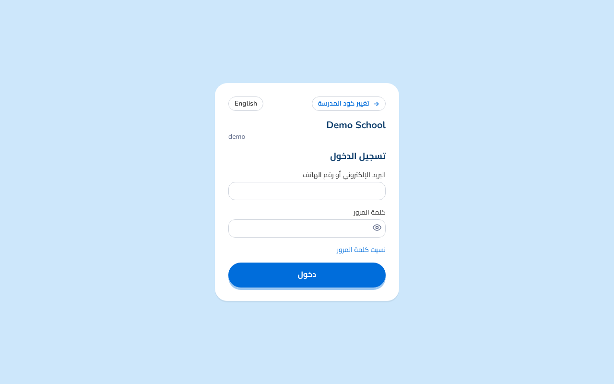

# دليل استخدام مدرستي

منصة مدرسية متكاملة: المدير، المعلمون، المحاسب، أولياء الأمور والطلاب في مكان واحد، بالعربية والإنجليزية.

| لمن | الدليل |
|---|---|
| إدارة المدرسة (المدير) | [admin.md](admin.md) |
| المعلم ورئيس القسم | [teacher.md](teacher.md) |
| المحاسب | [accountant.md](accountant.md) |
| ولي الأمر | [parent.md](parent.md) |
| الطالب | [student.md](student.md) |
| تشغيل مدرسة جديدة خطوة بخطوة | [school-start.md](school-start.md) |
| سيناريو عرض النظام على مدرسة (15 دقيقة) | [demo-script.md](demo-script.md) |

## الدخول
1. افتح رابط المدرسة (أو أدخل **رمز المدرسة**).
2. اكتب البريد الإلكتروني أو رقم الهاتف وكلمة المرور، ثم **دخول**. أول مرة ستُطلب منك كلمة مرور جديدة.
3. غيّر اللغة من قائمة حسابك (أعلى الصفحة) بين العربية والإنجليزية.

## أعلى كل صفحة
أيقونات التواصل: **المحادثات، الإعلانات، أخبار الصف، الإشعارات**، وقائمة حسابك (اللغة، كلمة المرور، **الخصوصية وبياناتي**، الخروج). في أسفل كل صفحة روابط **سياسة الخصوصية وشروط الاستخدام والكوكيز**.

## ترتيب شاشتك كما تحب
في صفحتك الرئيسية (وقائمة المدير الجانبية) زر **ترتيب**: حرّك العناصر بالأسهم، اختر حجم الأيقونات ولون كل أيقونة. ترتيبك يُحفظ على حسابك فقط.

## حسابات التجربة (نسخة العرض فقط)
| الدور | الدخول | كلمة المرور |
|---|---|---|
| المدير | admin@demo.test | Admin12345 |
| معلم | teacher1@demo.test | Teacher12345 |
| رئيس قسم | head1@demo.test | Teacher12345 |
| محاسب | accountant1@demo.test | Teacher12345 |
| ولي أمر | parent1@demo.test | 123456789 |
| طالب | ahmad.d1001@demo.edu | 123456789 |

لتحديث لقطات الشاشة في الدليل: `php artisan tenants:run showcase:seed --tenants=demo` ثم سكربت التصوير (انظر `demo-script.md`).
