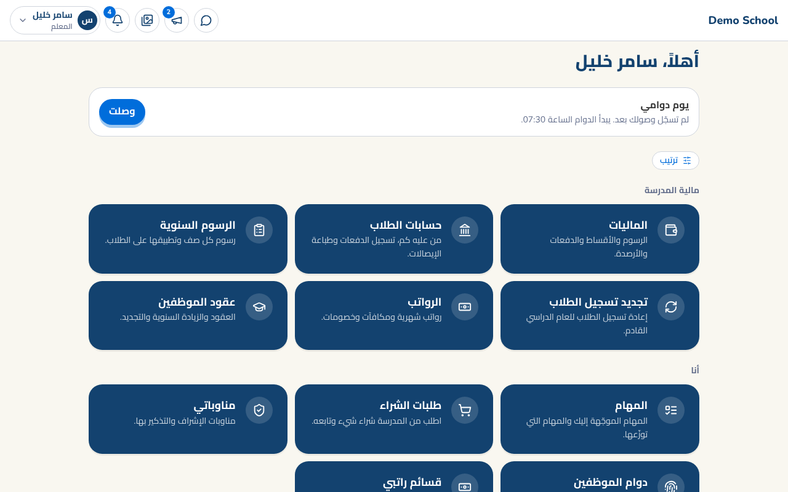
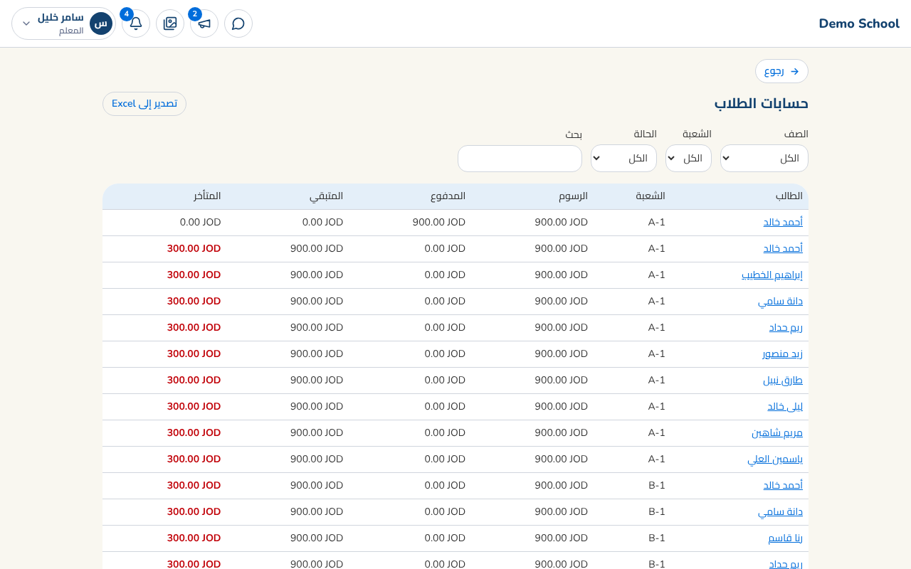
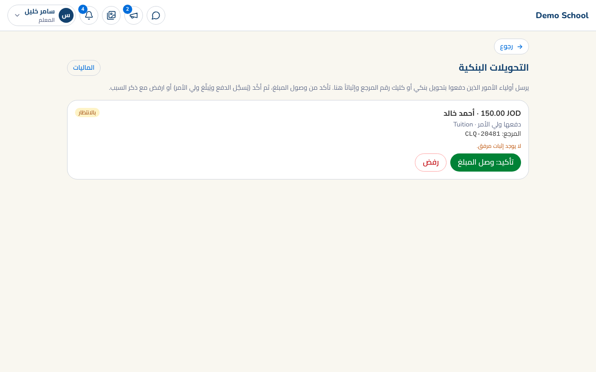
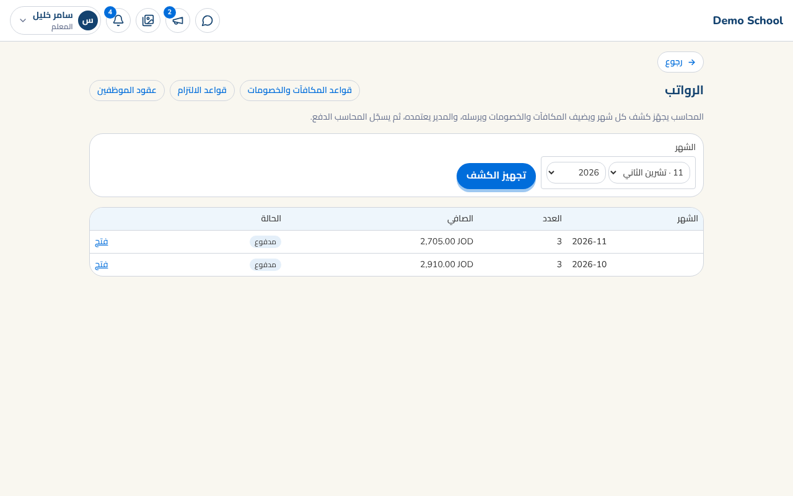

# دليل المحاسب

بعد الدخول تظهر لك المالية: الرسوم، الحسابات، العقود والرواتب.

## حسابات الطلاب والدفعات
- **الحسابات**: كل الطلاب مع المدفوع والمتبقي والمتأخر. افتح طالباً لتسجل دفعة (نقداً، شيك، تحويل بنكي) فيصدر **سند قبض** باسم الدافع. 
- **هيكل الرسوم**: رسوم كل صف وخطة الأقساط؛ تُطبَّق تلقائياً على الطلاب. 
- **المواصلات** تُضاف كبند ضمن حساب الطالب ويمكن تغييرها إذا انتقل لمنطقة أخرى.

## الدفع الإلكتروني والتحويلات
- **الدفع بالبطاقة (PayTabs)**: في المالية أدخل *Profile ID* و*Server key* من لوحة PayTabs، واختر المنطقة، واضغط **اختبار الاتصال** ثم فعّل. المفتاح يُحفظ مشفراً ولا يظهر مرة ثانية. 
- **التحويل البنكي / كليك**: أضف حساب المدرسة وتعليماتها وفعّلها. 
- **التحويلات البنكية**: عندما يرسل ولي أمر مرجع التحويل وصورة الإشعار يصلك إشعار. راجع الإثبات ثم **وصل المبلغ** (تُسجَّل الدفعة تلقائياً ويُبلَّغ الأب) أو **رفض** مع سبب يقرؤه الأب.

## الرواتب
1. **العقود**: راتب كل موظف وبنوده الشهرية ومدة العقد (تنبيه قبل الانتهاء). 
2. **تجهيز الراتب**: اختر الشهر ← تُنشأ كشوف الرواتب مع **الخصومات والمكافآت التلقائية** (الغياب، الالتزام بالدوام، الملخصات). 
3. إذا تغيّر الحضور بعد التجهيز اضغط **تحديث من الحضور**. 
4. **إرسال للاعتماد** ← المدير يعتمد ← **تسجيل الدفع** لكل موظف بطريقته (نقد، شيك، تحويل).

