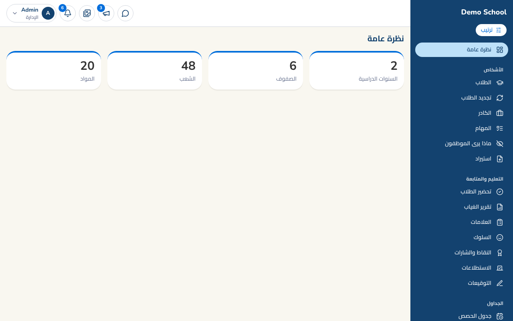
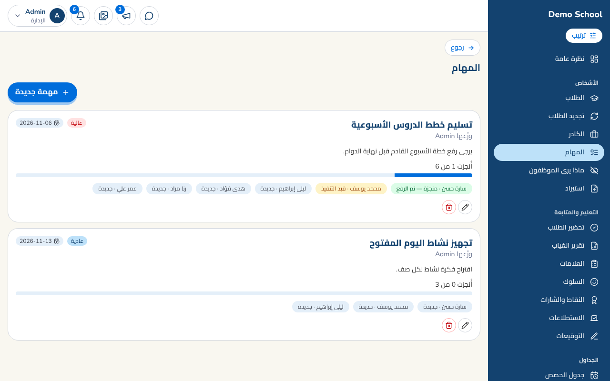
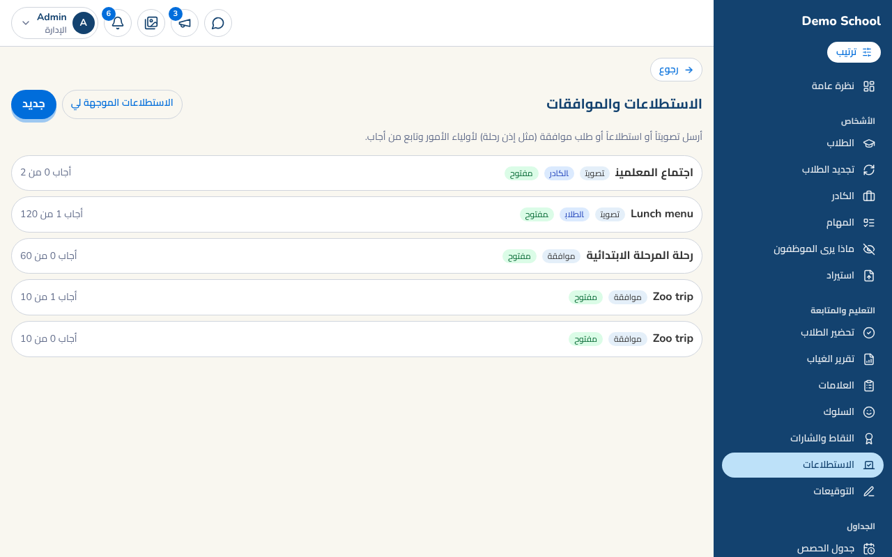
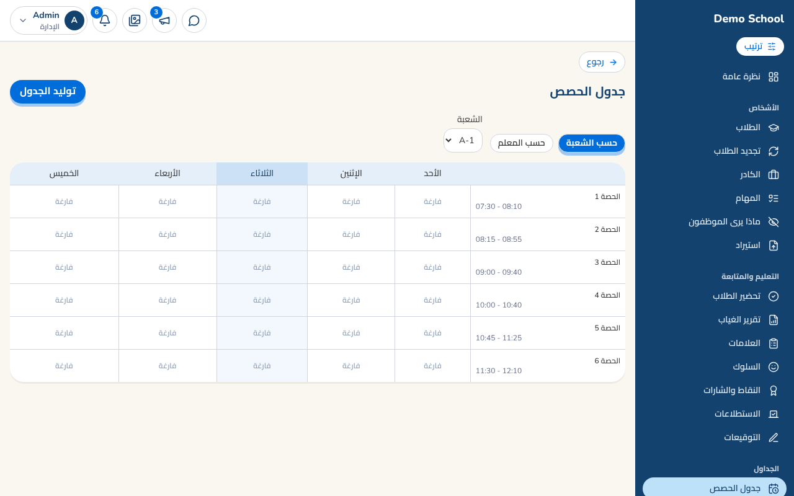
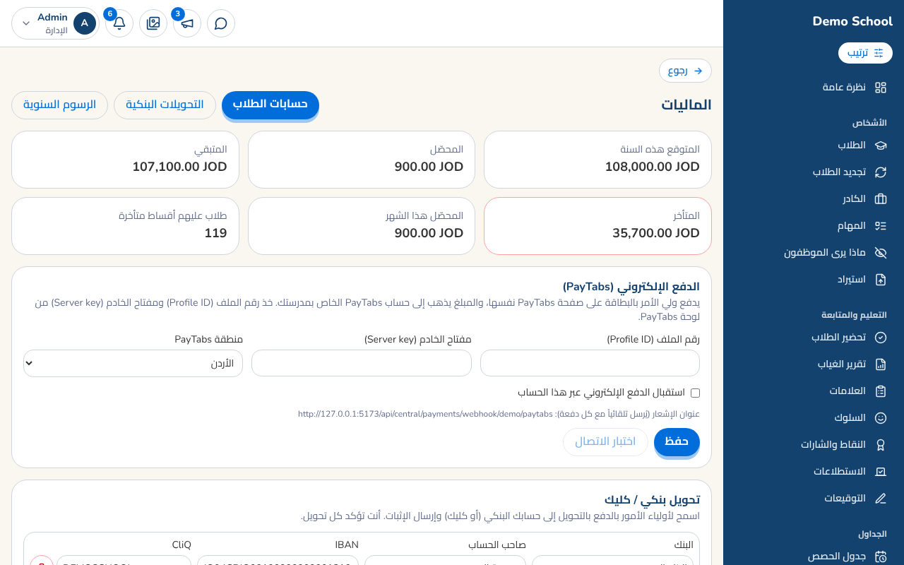
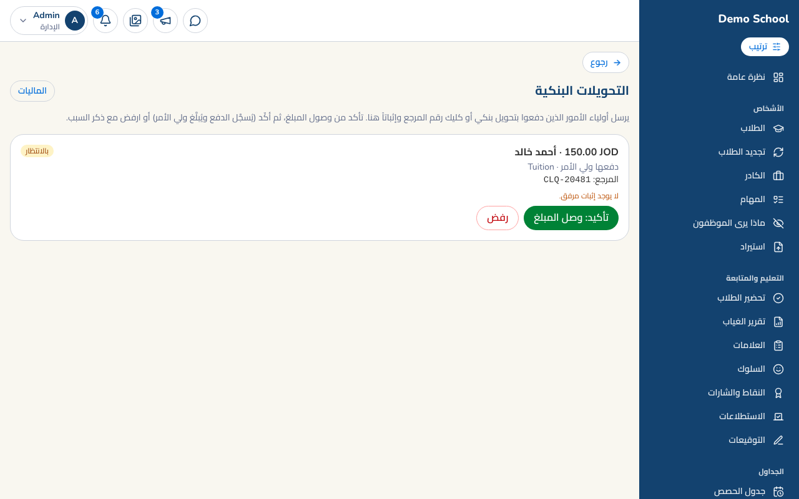
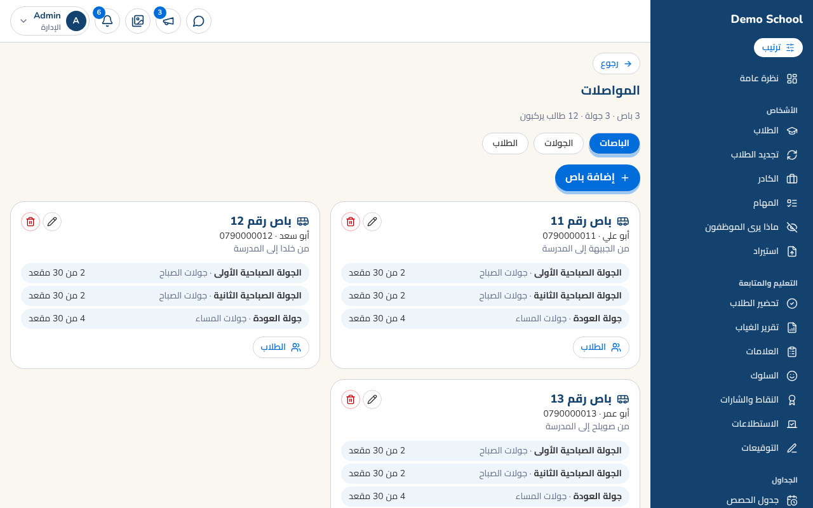
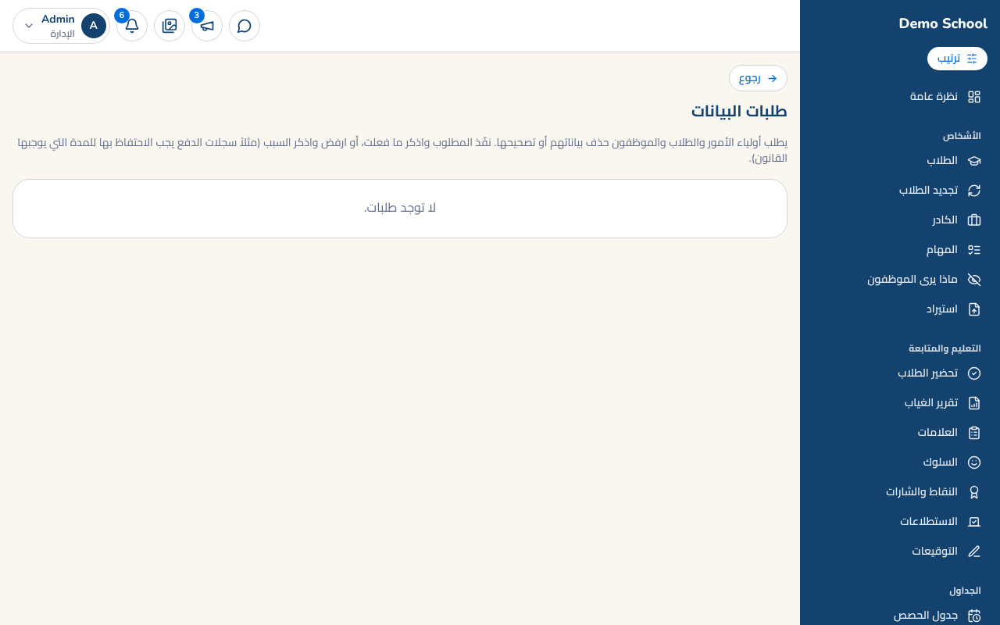
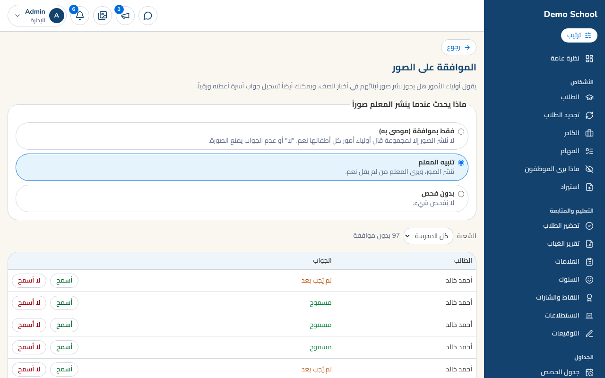

# دليل المدير

الصفحة الرئيسية للمدير فيها نظرة عامة، والقائمة الجانبية مقسمة لمجموعات (الأشخاص، التعليم والمتابعة، الجداول، المال والموظفون، إعداد المدرسة، النظام). يمكنك ترتيبها بزر **ترتيب**.

## 1) الأشخاص
- **الطلاب**: إضافة طالب (مع حساب ولي أمر تلقائي ورسوم الصف)، أو استيراد من Excel. 
- **الكادر**: المعلمون والإداريون ونوع وظيفة كل واحد. 
- **ماذا يرى الموظفون**: تقرر أي الشاشات تظهر لكل موظف (مثلاً إخفاء المالية عن معلم). 
- **المهام**: توزّع مهاماً على المعلمين (واحد أو الكل)، مع موعد وأولوية ومرفقات، وتتابع من أنجز.

## 2) التعليم والمتابعة
تحضير الطلاب، تقرير الغياب، العلامات، السلوك، النقاط والشارات، الاستطلاعات والموافقات (مع إرفاق صورة)، والتوقيعات.

## 3) الجداول
الجدول الأسبوعي (يُولَّد تلقائياً بلا تعارض)، **الامتحانات** (الشهرية والنهائية مع المراقبين)، و**المناوبات** (توزيع عادل يتجنب الحصص).

## 4) المال والموظفون
- **المالية**: ملخص الرسوم والمتأخرات، حسابات الطلاب، طرق الدفع الإلكتروني. 
- **التحويلات البنكية**: تراجع إثبات ولي الأمر وتؤكد "وصل المبلغ" أو ترفض مع سبب.
- **الرواتب**: العقود، قواعد المكافأة والخصم (الالتزام والغياب)، تجهيز راتب الشهر واعتماده.
- **المواصلات**: الجولات (صباحية ومسائية)، الباصات (السائق، المنطقة، المقاعد)، وركوب كل طالب (ذهاب وعودة).

## 5) النظام والخصوصية
- **سجل التدقيق**: كل تغيير على العلامات والحضور والرسوم.
- **طلبات البيانات**: أولياء الأمور والموظفون يطلبون حذف/تصحيح بياناتهم؛ ترد بـ"تم" أو "رفض" مع السبب.
- **الموافقة على الصور**: ولي الأمر يسمح أو لا بنشر صور ابنه؛ تختار سياسة المدرسة (بموافقة فقط، أو تنبيه، أو بدون فحص).

## نصائح
- ابدأ بـ [تشغيل مدرسة جديدة](school-start.md).
- اضغط **ترتيب** لتضع ما تستخدمه أكثر فوق، وغيّر ألوان الأيقونات.
- الإشعارات (الجرس) تنبهك: تحويل جديد، طلب بيانات، مهمة أُنجزت.
