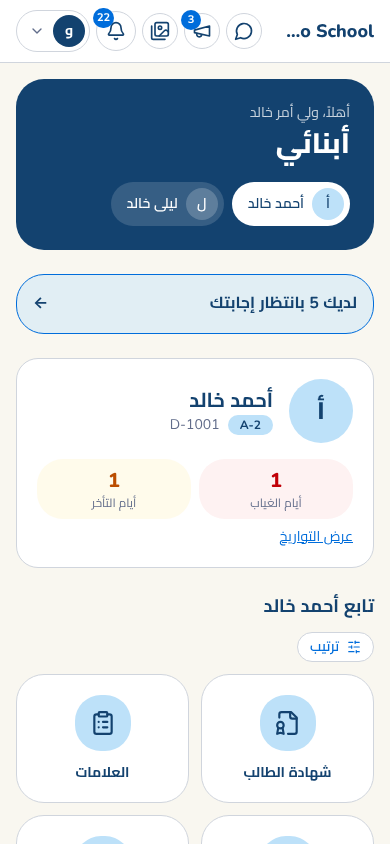
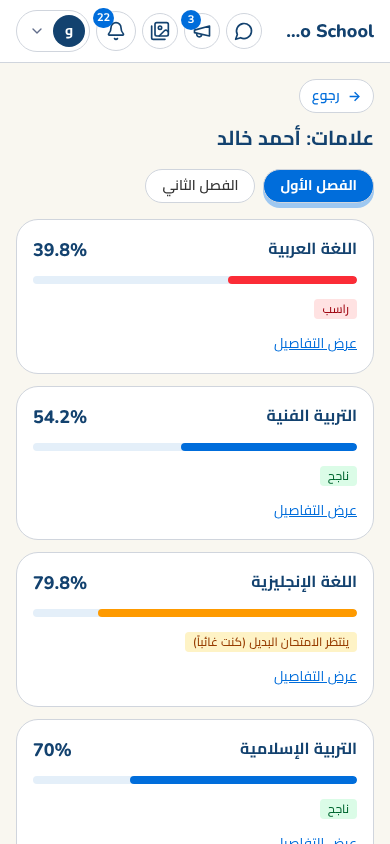
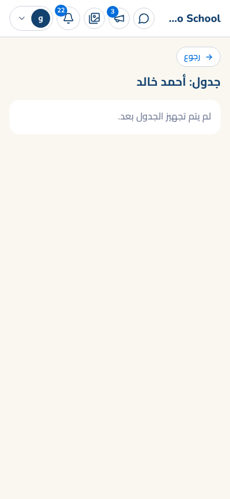
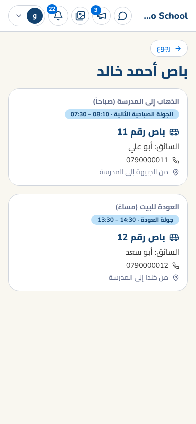
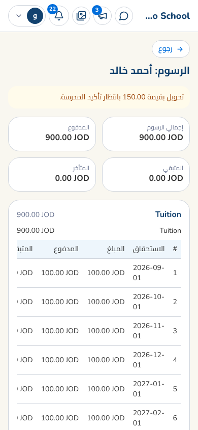
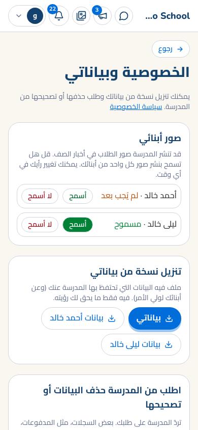
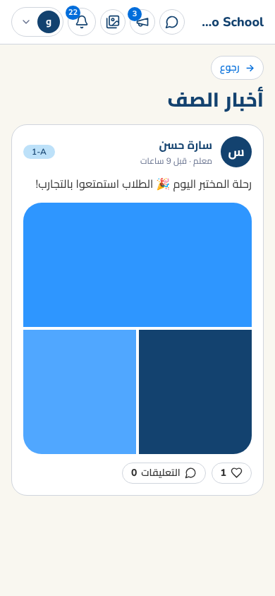

# دليل ولي الأمر

مصمَّم للجوال. اختر ابنك من الأعلى (إن كان لديك أكثر من ابن) ثم الأقسام كأيقونات.

## ماذا تجد
- **العلامات والشهادة**، **الجدول**، **الواجبات**، **ملخص اليوم**، **خطط الدروس**، **السلوك والنقاط**، **الامتحانات**. 
- **الغياب والتأخر** لكل ابن بأعلى الصفحة (اضغط "عرض التواريخ"). 
- **الاستطلاعات والموافقات** (مثل رحلة مدرسية): أجب وأرفق ما يلزم.
- **أخبار الصف** (الأيقونة بالأعلى): صور وأخبار من معلمي ابنك. 
- **المواصلات**: رقم الباص والسائق والمنطقة، للذهاب والعودة (قد يختلفان).

## الرسوم والدفع
في **الرسوم** ترى الأقساط والمدفوع والمتبقي. اضغط **الدفع الإلكتروني** وتختار حسب ما تقدمه المدرسة:
- **بطاقة**: تنتقل لصفحة شركة الدفع الآمنة، ثم تعود ويظهر السند. 
- **تحويل بنكي / كليك**: ترى حساب المدرسة، تحوّل، ثم تكتب **رقم المرجع** وتُرفق **صورة الإشعار**. تؤكد المدرسة التحويل وتصلك رسالة (أو سبب الرفض).

## خصوصيتك
قائمة حسابك ← **الخصوصية وبياناتي**:
- **السماح بنشر صور ابنك** في أخبار الصف أو عدمه (يمكنك تغيير رأيك في أي وقت). 
- **تنزيل نسخة** من بياناتك وبيانات أبنائك. 
- **طلب حذف أو تصحيح** بيانات، وتقرأ رد المدرسة.

## أخبار الصف

