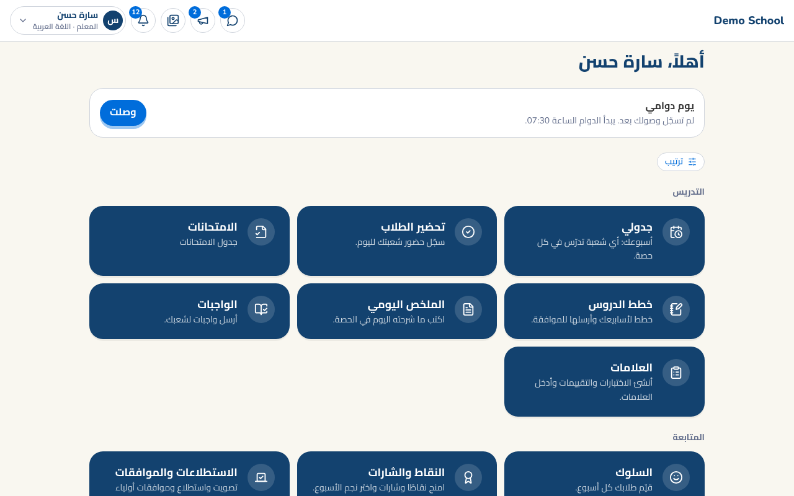
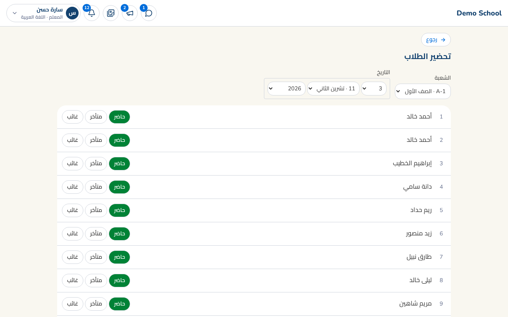
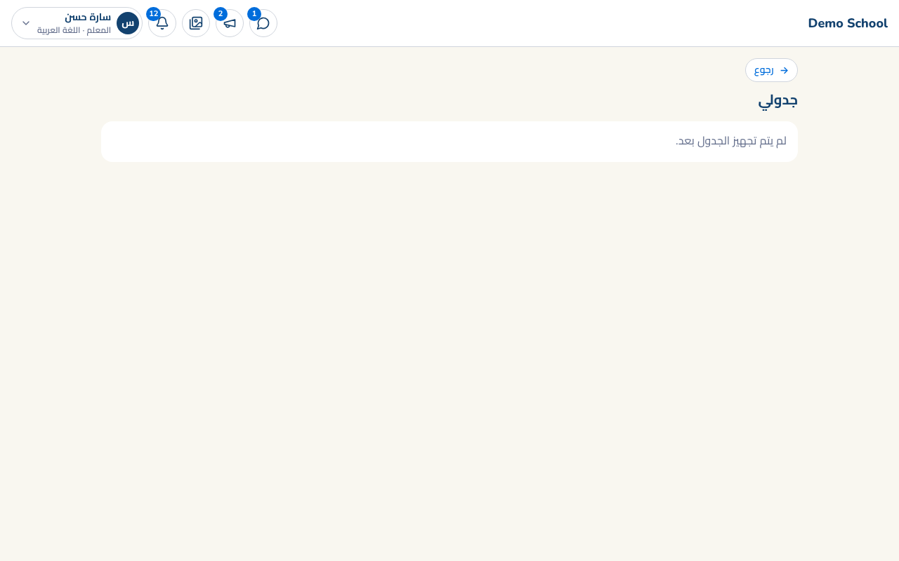
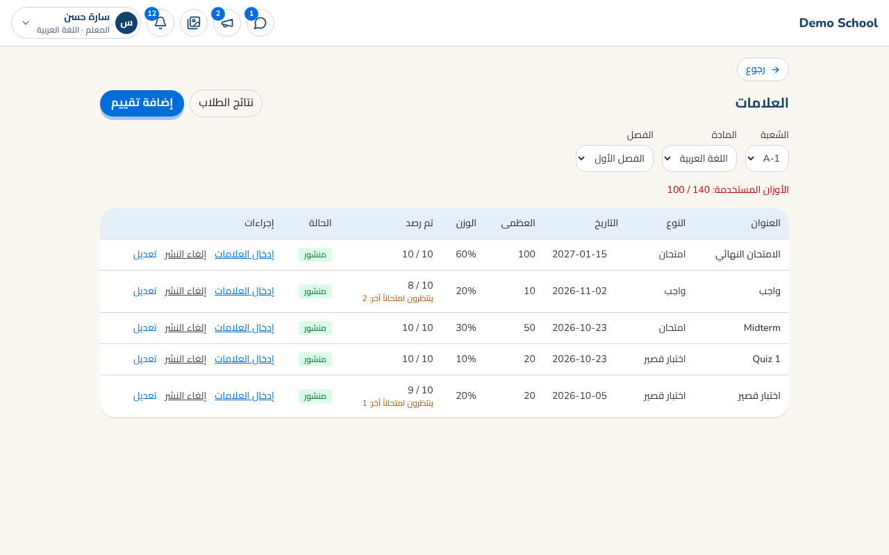
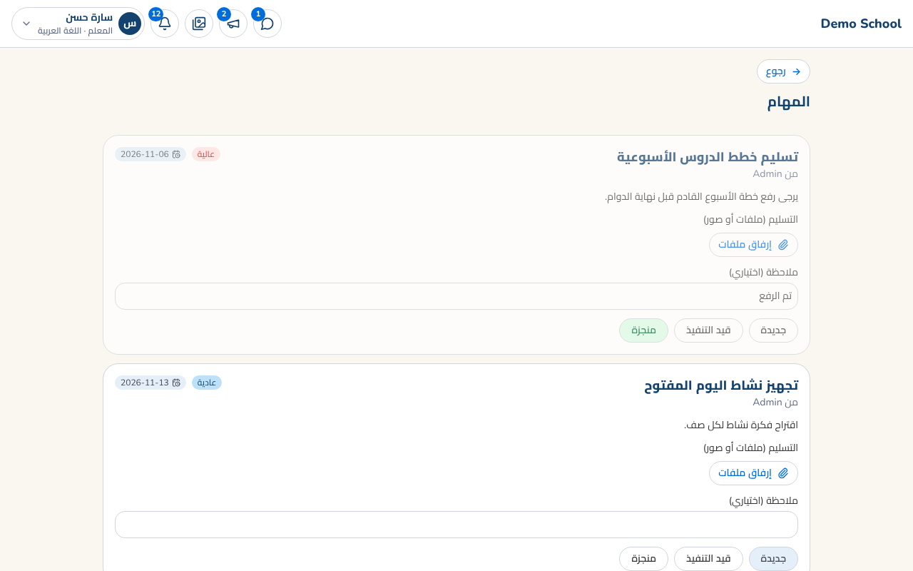
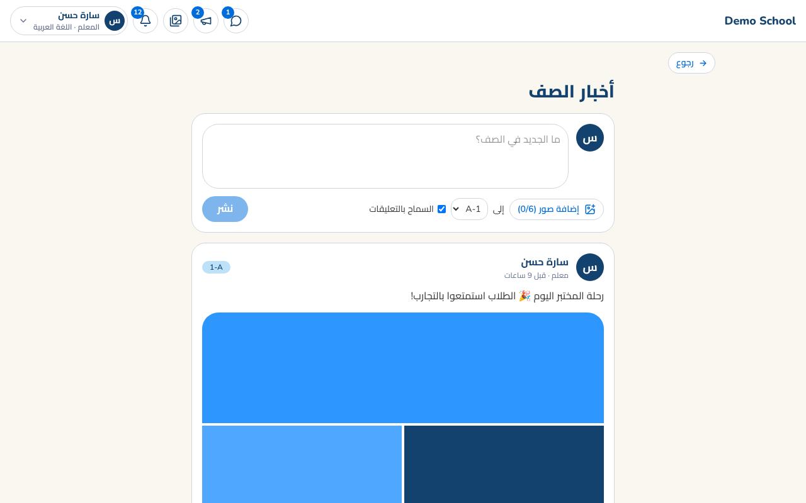
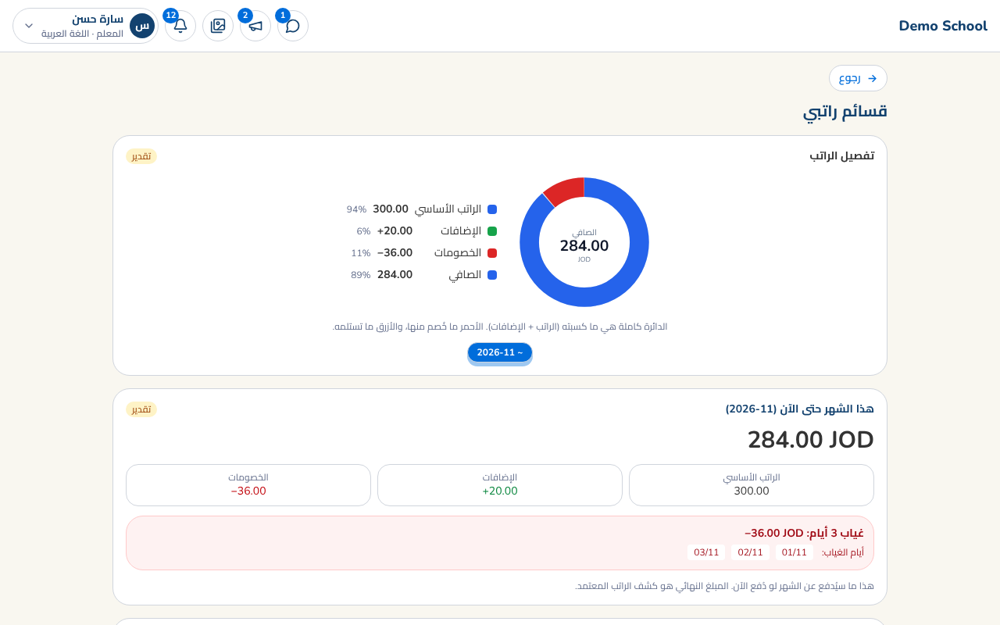

# دليل المعلم ورئيس القسم

صفحتك الرئيسية: بطاقة **تسجيل الحضور والانصراف** أولاً، ثم أدواتك في مجموعات (التدريس، المتابعة، قسمي لرئيس القسم، عملي).

## كل يوم
1. **سجّل حضورك** من البطاقة عند الوصول، وانصرافك عند المغادرة. 
2. **جدولي**: حصصك للأسبوع. 
3. **تحضير الطلاب**: لصفك الرئيسي، ثم احفظ. 
4. **ملخص الحصة والواجبات**: اكتب ملخص الدرس وأرسل الواجب (مع صور اختيارية).

## العلامات
أنشئ تقييماً (اختبار، واجب...) وأدخل العلامات للطلاب. اترك الخانة فارغة لـ"غير مُقيَّم"، وسجّل **غائب** ليحصل على امتحان تعويضي.

## المهام
تصلك مهام من المدير أو رئيس القسم: غيّر الحالة (جديدة، قيد التنفيذ، منجزة) وأرفق ملفات أو صوراً كتسليم. رئيس القسم يوزّع مهاماً على معلمي قسمه.

## أخبار الصف
شارك صوراً وكلاماً مع صفك. إذا لم يسمح بعض أولياء الأمور بنشر صور أبنائهم سيظهر لك تنبيه بالأسماء (وقد تمنع المدرسة النشر إلى أن يسمحوا).

## راتبي
أعلى الصفحة دائرة توضح الراتب: الأزرق ما تستلمه والأحمر ما خُصم (مثلاً الغياب)، مع تواريخ الأيام. هذا تقدير والمبلغ النهائي هو كشف الراتب المعتمد.

## للمساعدة
قائمة حسابك ← **الخصوصية وبياناتي** لتنزيل نسخة من بياناتك أو طلب تصحيحها.
